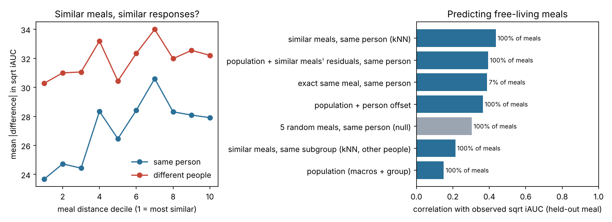

# First test on real data: CGMacros glucose responses

Status 14 November 2026. Code: `scripts/cgmacros_analysis.py`. Aggregate results: `results/cgmacros/`.
Raw data are not in the repository (CC BY-NC-SA 4.0); `scripts/fetch_cgmacros.sh` downloads them.

## Short version

- **The food trees cannot be tested on CGMacros.** The meal log has calories, carbohydrate, protein,
  fat and fibre per meal and a photo, but no food items or food codes. Everything below works at the
  level of whole meals described by four macronutrients. Testing the food trees would need the
  photos coded into foods first.
- **Responses are strongly personal.** The same standardised breakfast eaten twice by the same person
  gives similar responses (test-retest ICC 0.62 to 0.79 across the four breakfasts). Two people eating
  the same meal differ about twice as much as one person eating it twice (mean |difference| in
  sqrt iAUC 28.8 vs 14.5).
- **Similar meals give somewhat similar responses, but the meal-similarity signal is weak with only
  macros.** Within a person, the response difference grows with meal distance (Spearman 0.07, p = 0.001).
  Predicting a free-living meal from the same person's five most similar meals beats a population model
  clearly (r 0.44 vs 0.15), but most of that gain is the person, not the meal: five *random* meals of
  the same person give r 0.30, twenty random meals as much as twenty similar ones, and the gain over a
  population model with a person offset (+0.07, 95% CI -0.03 to 0.15) is not significant.
- **Pooling similar meals solves the coverage problem.** Only 7% of free-living meals have an exact
  repeat by the same person, so "every meal is unique" leaves 93% of meals with no personal history.
  On meals that do have an exact repeat, similar-meal pooling predicts as well as the exact repeat
  (r 0.76 vs 0.73), and better when combined with a population model (0.80). This is the real-data
  version of the H1 argument, at the meal level.
- **Personal response level transfers from controlled to free-living meals.** A person's offset on the
  standardised meals predicts their offset on free-living meals (Spearman 0.72; 0.63 within HbA1c
  group). Part of this is the sensor: with free-living offsets from the second sensor (Dexcom) the
  agreement falls to 0.47 (0.32 within group, p = 0.04). So there is a stable personal phenotype, but
  about half of the apparent stability is probably sensor-specific calibration.
- **Relative dose (H6): small and inconsistent support.** Over all meals, intake as a percentage of
  estimated energy requirement fits better than grams (ΔAIC 11 for Mifflin-St Jeor, 7 for
  Harris-Benedict; leave-one-person-out R² 0.104 vs 0.093). On the standardised meals the difference is
  2 AIC units and on free-living meals none. Body weight as a covariate never helps. Fitbit-measured
  expenditure as the denominator does worse than either equation.
- **Subgroups: level, not slope.** People with type 2 diabetes respond more to every meal (median iAUC
  3,700 vs 1,600 mg/dL·min on standardised meals), but on the controlled meals the response per 10 g of
  carbohydrate does not differ by HbA1c group (interaction p 0.5 to 0.6).
- **Energy state matters.** A longer gap since the previous meal gives a larger response, more energy
  eaten in the previous 4 hours a smaller one, and a higher pre-meal glucose a smaller increment. The
  same standardised breakfast and lunch differ a lot (T2D median iAUC 6,050 at breakfast vs 1,870 at
  lunch for meals of similar energy), which a time-of-day or energy-state model would need to explain.

## Data

CGMacros v1.0.0 ([PhysioNet](https://physionet.org/content/cgmacros/1.0.0/),
[data paper](https://pmc.ncbi.nlm.nih.gov/articles/PMC12462512/)): 45 adults, 15 healthy, 16 with
prediabetes, 14 with type 2 diabetes by laboratory HbA1c (<5.7, 5.7-6.4, ≥6.5%); about 10 days each with
Abbott Libre Pro and Dexcom G6 CGMs, Fitbit, a baseline blood panel and gut microbiome.

**Provenance caveat.** PhysioNet was not reachable from the cloud session, so this run used a public
GitHub copy of the 45 participant files and `bio.csv`. The files match the PhysioNet description
(45 participants, the same columns and participant numbering), but they were not checked against
PhysioNet's checksums. Rerun on the official download before using the numbers in a paper.

Meals: 1,706 entries; 45 with 0 kcal (water, empty logs) were dropped, leaving 1,661. 861 are one of
16 standardised meals (a macro profile logged by at least 20 people: the study's breakfasts and
lunches); dinners and snacks are free-living. 1,405 meals had a full glucose window and no other meal
in the following 2 hours and were analysed (830 standardised, 575 free-living).

Data problems found and handled:

- one participant logged fibre in the hundreds or thousands of grams (26 entries); set to missing and
  filled with the meal-type median;
- the "Amount Consumed" column mixes units (100, 1, 2, 300, 0...) and was ignored, so logged macros
  are taken as eaten;
- body weight is in pounds and height in inches in `bio.csv`;
- the Libre trace is one value per minute, interpolated from 15-minute readings.

## Methods

- **Response**: incremental area under the Libre curve for 120 minutes above the mean of the 15 minutes
  before the meal (positive area only), analysed as sqrt(iAUC) because 7% of meals have iAUC 0. Peak
  rise and Dexcom iAUC are also computed (Libre vs Dexcom iAUC Spearman 0.84).
- **Energy requirement**: Harris-Benedict as revised by Roza and Shizgal (1984) and Mifflin-St Jeor,
  both × 1.5 (no individual activity level is recorded), and the median Fitbit total for full days.
  Relative dose of each macronutrient = its energy as % of the daily requirement.
- **Meal distance**: built like the food distance in `foodspace`. "How much": Euclidean distance on
  z-scored log(1 + g) of carbohydrate, protein, fat and fibre. "What kind": Aitchison distance on the
  energy shares (CLR, zeros replaced with 0.001). Each scaled to 0-1 by its maximum; fused = mean.
- **Models**: linear mixed models with a random intercept per person (ML), compared by AIC, and
  leave-one-person-out prediction with the same fixed effects.
- **Personal prediction**: every meal is predicted without itself by (1) a population model on macros
  and HbA1c group fitted without that person; (2) that plus the person's mean residual on their other
  meals; (3) the mean response of the same person's identical meals, where any exist; (4) the mean of
  the person's 5 most similar other meals; (5) the population model plus those 5 meals' residuals;
  (6) the mean of the 25 most similar meals of other people in the same HbA1c group. Differences in
  correlation get a 95% CI by resampling people.

## Results in more detail

### Personal prediction of free-living meals

| Method | Meals covered | r | RMSE |
|---|---|---|---|
| Population model (macros + group) | 100% | 0.15 | 26.9 |
| Similar meals of other people in the same subgroup | 100% | 0.21 | 24.8 |
| Population + person offset | 100% | 0.36 | 25.0 |
| Exact same meal, same person | **7%** | 0.39 | 29.9 |
| Population + similar meals' residuals, same person | 100% | 0.39 | 25.7 |
| 5 similar meals, same person | 100% | **0.44** | 23.6 |
| 5 random meals, same person (null) | 100% | 0.30 | 25.4 |

Sensitivity (`knn_sensitivity_free_living.csv`): with 1 to 5 neighbours, similar meals beat random
meals of the same person by 0.1 in r; with 20 neighbours they are equal (0.46 vs 0.45). The fused
distance is slightly better than composition or fraction alone at small k, but the three are within
0.03 of each other.

### Scaling intake (H5, H6)

| Meals | Absolute g | g + body weight | % EER, HB | % EER, MSJ | % Fitbit |
|---|---|---|---|---|---|
| All (ΔAIC) | 11.2 | 12.3 | 4.0 | **0** | 14.2 |
| Standardised (ΔAIC) | 2.1 | 3.6 | 0.5 | **0** | 12.6 |
| Free-living (ΔAIC) | **0** | 1.8 | 0.4 | 0.5 | 2.3 |

Why the test is weak: estimated requirements vary only about ±15% between these people, so dividing
by them barely changes the ranking of meals; and on standardised meals everyone eats the same grams,
so relative dose is a person-level variable confounded with sex and body size. A real test of H6 needs
meals scaled to the person by design, or a much wider range of body size.

### Subgroups

On standardised meals, sqrt(iAUC) per 10 g carbohydrate is 3.7 (healthy), 4.7 (prediabetes) and 4.8
(T2D), with overlapping CIs; groups differ mostly in overall level. Protein lowers the response
slightly and fibre more; fat has no clear effect at 2 hours. Free-living meals give flatter, noisier
slopes (free-living macros are estimates, not weighed).

## What this means for the paper

1. The data support the H7 premise (stable, personal responses to the same meal) and the coverage
   argument for pooling similar items (H1). They do **not** yet show that composition similarity adds
   much beyond "same person": with four macronutrients, meals are poorly separated. The food-level
   structure (what kind of carbohydrate, what foods) is exactly what is missing here.
2. The next step that would test the actual method is coding the CGMacros photos into foods (by hand
   for a sample, or with an image model) and placing them in the Nordic food tree. CGMacros' food
   culture (US) is a poor match for Swedish and Finnish tables; FNDDS codes would match better.
3. H6 needs a dataset or design where relative dose varies within people. Report the CGMacros result
   as weak and inconsistent support, not as evidence for or against.
4. The breakfast vs lunch gap and the energy-state terms are a natural worked example for the
   "energy-state cycle" and for a minimal glucose model.
5. The sensor check matters: any personal phenotype from CGM should be confirmed on a second sensor
   or on fingerstick glucose (CGMacros has three fingerstick values per person).

## Not done

- Microbiome (CGMacros has it; a link between personal response level and the microbiome would fit the
  digestion-efficiency idea, but n = 45).
- Peak rise and Dexcom as main outcomes (computed, not modelled).
- Any use of the meal photos.
